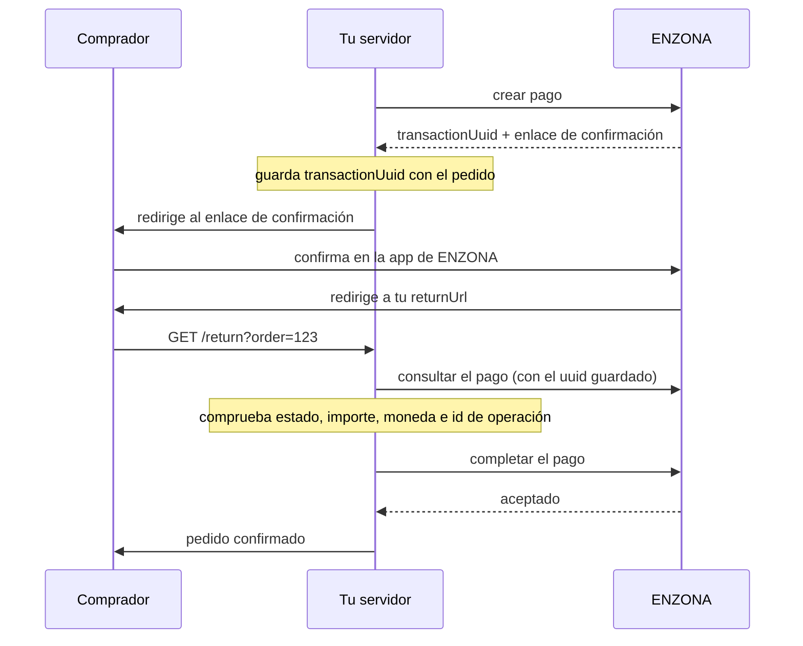

<div align="center">

<picture>
  <source media="(prefers-color-scheme: dark)" srcset="docs/assets/logo.png">
  
</picture>

**Un SDK de Java ligero, tipado y sin acoplamiento a frameworks para la API de pagos de ENZONA.**

`Java 17+` · `Compilado con JDK 17 LTS` · `Maven y Gradle` · `Sin frameworks` · `Mantenido por la comunidad`

[Inicio rápido](#inicio-rápido) · [Ejemplos](examples/) · [Cobertura de la API](docs/api-coverage.md) · [Flujo de pago](docs/payment-flow.md) · [English](README.md)

</div>

> **SDK no oficial.** Este proyecto lo mantiene la comunidad y no está afiliado, respaldado ni soportado por ENZONA ni por XETID.

> **Estado: pre-lanzamiento.** `2.0.0` es una reescritura completa y **todavía no está publicado en Maven Central**. Mira [Instalación](#instalación) para probarlo en local. Las versiones `1.x` de Maven Central nunca funcionaron contra la API real: no las uses ([por qué](docs/migration-1.x.md)).

  

---

## ¿Por qué este SDK?

- **Idiomático y tipado.** Respuestas inmutables (`record`) y builders que validan. Sin `Map<String, Object>` en tu código.
- **El dinero es `BigDecimal` y nunca se redondea.** ENZONA quiere los importes como texto con dos decimales; el SDK los escribe así y **rechaza** un valor con más decimales en lugar de redondearlo. El total del pago se calcula a partir de los ítems con la misma regla que valida el servidor, así evitas los errores 4083 y 4084.
- **Gestión del token incluida.** OAuth2 *client credentials*, en caché hasta poco antes de caducar, compartido entre hilos y renovado una vez si el gateway lo rechaza.
- **Síncrono y asíncrono.** Cada operación tiene un método bloqueante y otro `...Async` que devuelve un `CompletableFuture`.
- **Seguro por defecto.** Solo HTTPS, secretos ocultos en `toString()` y excepciones, sin redirecciones y **sin reintentos automáticos de las llamadas que crean, completan, cancelan o devuelven un pago**.
- **Sin acoplamiento a frameworks.** El `HttpClient` del JDK y una dependencia de ejecución (Jackson 3, fuera de la API pública). El mismo código sirve en Java puro, Spring Boot, Quarkus, Micronaut o AWS Lambda.

## Funcionalidades

| Funcionalidad | Desde | Estado |
|---|---|---|
| Pagos: crear, consultar, listar con filtros, completar, cancelar | 2.0.0 | Implementado, probado sin red |
| Devoluciones: totales y parciales, consultar, listar, las de un pago | 2.0.0 | Implementado, probado sin red |
| Entornos producción y sandbox, gestión del token OAuth2 | 2.0.0 | Implementado, probado sin red |
| Reintentos opcionales solo para lecturas | 2.0.0 | Implementado, probado sin red |
| Pagos con QR (`/qr/v1.0.0`) | previsto 2.1.0 | No implementado |
| Reclamaciones, contabilidad | desconocido | Sin contrato público |

ENZONA publica la referencia de su API solo para comercios registrados, así que el contrato se reconstruyó a partir de varios SDK de la comunidad (mira [docs/references.md](docs/references.md) y [docs/api-coverage.md](docs/api-coverage.md) para cada endpoint y las dudas abiertas). "Probado sin red" significa pruebas de contrato con simulaciones y datos de prueba reconstruidos. **Todavía no se ha ejecutado nada contra ENZONA y ninguna prueba mueve dinero real.** Pruébalo primero en el sandbox.

## Requisitos

- **Java 17 o superior** (compilado con JDK 17 LTS, compatibilidad comprobada también en Java 21). Java 8 y 11 no están soportados.
- Maven o Gradle.
- Un comercio en ENZONA y una aplicación con **consumer key y secret**, creada en el API Store de ENZONA tras registrarte en [bulevar.enzona.net](https://bulevar.enzona.net). Sandbox y producción usan claves distintas.
- El consumer secret va en tu **servidor**. Nunca lo envíes a un navegador ni a una app móvil.

## Instalación

> **Estado del paquete: aún no publicado en Maven Central.** Hasta entonces, compílalo en local y depende de la versión snapshot:

```bash
git clone https://github.com/Alejo2075/enzona-sdk-java.git
cd enzona-sdk-java
./mvnw install -DskipTests      # necesita JDK 17 o superior
```

**Maven**

```xml
<dependency>
  <groupId>io.github.alejo2075</groupId>
  <artifactId>enzona-sdk</artifactId>
  <version>2.0.0</version>
</dependency>
```

**Gradle (Kotlin DSL)**

```kotlin
repositories {
    mavenLocal()      // solo hasta que se publique 2.0.0
    mavenCentral()
}

dependencies {
    implementation("io.github.alejo2075:enzona-sdk:2.0.0")
}
```

**Gradle (Groovy DSL)**

```groovy
repositories {
    mavenLocal()      // solo hasta que se publique 2.0.0
    mavenCentral()
}

dependencies {
    implementation 'io.github.alejo2075:enzona-sdk:2.0.0'
}
```

Proyectos completos: [examples/plain-java](examples/plain-java) (Maven), [examples/gradle-java](examples/gradle-java) (Kotlin DSL), [examples/gradle-groovy](examples/gradle-groovy) (Groovy DSL) y [examples/return-handler](examples/return-handler) (un servidor para el regreso del comprador).

## Inicio rápido

Exporta las credenciales **sandbox** de tu aplicación:

```bash
export ENZONA_CONSUMER_KEY=tu-consumer-key
export ENZONA_CONSUMER_SECRET=tu-consumer-secret
```

Crea el cliente una sola vez y compártelo (es seguro entre hilos y guarda el token en caché):

<!-- snippet:plain-java/QuickStart.java#client -->
```java
EnzonaClient client = EnzonaClient.builder()
        .credentials(System.getenv("ENZONA_CONSUMER_KEY"), System.getenv("ENZONA_CONSUMER_SECRET"))
        .environment(Environment.SANDBOX)
        .build();
```

Crea un pago y envía al comprador a ENZONA:

<!-- snippet:plain-java/QuickStart.java -->
```java
Payment payment = client.payments().create(
        CreatePaymentRequest.builder()
                .description("Order #123")
                .currency("CUP")
                .item(PaymentItem.of("T-shirt", 2, new BigDecimal("50.00"), new BigDecimal("2.00")))
                .shipping(new BigDecimal("10.00"))
                .merchantOpId("123456789012")
                .returnUrl("https://shop.example/enzona/return?order=123")
                .cancelUrl("https://shop.example/enzona/cancel?order=123")
                .build());

System.out.println("Send the buyer to: " + payment.confirmationUrl().orElseThrow());
System.out.println("Keep this next to your order: " + payment.transactionUuid());
```

Imports:

<!-- snippet:plain-java/QuickStart.java#imports -->
```java
import io.github.alejo2075.enzona.Environment;
import io.github.alejo2075.enzona.EnzonaClient;
import io.github.alejo2075.enzona.model.CreatePaymentRequest;
import io.github.alejo2075.enzona.model.Payment;
import io.github.alejo2075.enzona.model.PaymentItem;
import java.math.BigDecimal;
```

El `total` se calcula por ti: `Σ(precio × cantidad) + impuesto + envío + propina − descuento`, donde `impuesto` es la suma de los impuestos de los ítems. La versión completa y compilable es [QuickStart.java](examples/plain-java/src/main/java/example/QuickStart.java).

## Flujo de pago



**No hay webhooks firmados** y ENZONA no añade el identificador del pago a tu `returnUrl`: guarda el `transactionUuid` junto al pedido y pon tu propia referencia del pedido en la URL de retorno. **La redirección no prueba nada**; el pago solo se cobra cuando lo completas. El SDK no aloja ningún endpoint HTTP. Detalles: [docs/payment-flow.md](docs/payment-flow.md).

## Ejemplos de uso

### Verificar el regreso y completar el pago

<!-- snippet:plain-java/PaymentFlow.java#checkout -->
```java
Payment payment = client.payments().create(
        CreatePaymentRequest.builder()
                .currency("CUP")
                .description("Order " + orderId)
                .item(PaymentItem.of("Course", 1, new BigDecimal("250.00"), BigDecimal.ZERO))
                .generateMerchantOpId()
                .returnUrl("https://shop.example/enzona/return?order=" + orderId)
                .cancelUrl("https://shop.example/enzona/cancel?order=" + orderId)
                .build());

// ENZONA does not put the uuid in the return URL: store it with the order now.
orders.put(orderId, new Order(orderId, payment.amount().total(), payment.currency(),
        payment.merchantOpId(), payment.transactionUuid()));

return payment.confirmationUrl().orElseThrow();
```

<!-- snippet:plain-java/PaymentFlow.java#return -->
```java
Order order = orders.get(orderId);
Payment payment = client.payments().get(order.transactionUuid());

if (payment.status() == PaymentStatus.ACCEPTED) {
    return Outcome.PAID; // already completed: handling the return twice is harmless
}
if (payment.status() != PaymentStatus.CONFIRMED) {
    return Outcome.NOT_CONFIRMED;
}
boolean matches = order.currency().equals(payment.currency())
        && order.merchantOpId().equals(payment.merchantOpId())
        && order.total().compareTo(payment.amount().total()) == 0;
if (!matches) {
    return Outcome.MISMATCH;
}

// Completing the payment is what charges the buyer. It is never retried by the SDK.
Payment completed = client.payments().complete(order.transactionUuid());
return completed.status() == PaymentStatus.ACCEPTED ? Outcome.PAID : Outcome.NOT_CONFIRMED;
```

> **Completar un pago cobra al comprador.** El SDK nunca lo reintenta. Si `complete` falla con un error de transporte el resultado es incierto: consulta el pago con `get` y mira su estado antes de intentarlo otra vez.

### Devoluciones

<!-- snippet:plain-java/Refunds.java#partial -->
```java
Refund refund = client.refunds().create(
        transactionUuid,
        RefundRequest.builder()
                .amount(new BigDecimal("50.00"))
                .description("Damaged item")
                .build());
System.out.println("Refund " + refund.transactionUuid() + ": " + refund.status());
```

<!-- snippet:plain-java/Refunds.java#full -->
```java
return client.refunds().create(transactionUuid);
```

> Una devolución devuelve dinero al comprador y **nunca se reintenta**. Tras un error de transporte, lista las devoluciones del pago antes de devolver otra vez.

### Llamadas asíncronas

<!-- snippet:plain-java/AdvancedUsage.java#async -->
```java
return client.payments()
        .getAsync(transactionUuid)
        .thenApply(Payment::status);
```

### Timeouts y reintentos de lecturas

<!-- snippet:plain-java/AdvancedUsage.java#tuned -->
```java
EnzonaClient client = EnzonaClient.builder()
        .credentials(System.getenv("ENZONA_CONSUMER_KEY"), System.getenv("ENZONA_CONSUMER_SECRET"))
        .environment(Environment.PRODUCTION)
        .connectTimeout(Duration.ofSeconds(5))
        .requestTimeout(Duration.ofSeconds(20))
        // Retries apply to reads only; create, complete, cancel and refund are never retried.
        .retryPolicy(RetryPolicy.exponentialBackoff(3, Duration.ofMillis(200), Duration.ofSeconds(2)))
        .build();
```

### Manejo de errores

Actúa sobre el código numérico, nunca sobre el mensaje: los mensajes de ENZONA son texto en español y pueden cambiar.

<!-- snippet:plain-java/AdvancedUsage.java#errors -->
```java
try {
    Refund refund = client.refunds().create(transactionUuid);
    return "Refunded: " + refund.transactionUuid();
} catch (ValidationException e) {
    // The numeric ENZONA code is stable; the message is Spanish prose and may change.
    if (e.knownErrorCode().orElse(EnzonaErrorCode.UNKNOWN) == EnzonaErrorCode.PAYMENT_ALREADY_FULLY_REFUNDED) {
        return "Already refunded";
    }
    return "ENZONA rejected the refund, code " + e.errorCode();
} catch (RateLimitException e) {
    return "Too many requests, retry in " + e.retryAfter().orElse(Duration.ofSeconds(5));
} catch (AuthenticationException | TokenException e) {
    return "Check the consumer key, the secret and the environment";
}
```

| HTTP | Excepción |
|---|---|
| 400 | `ValidationException` |
| 401 | `AuthenticationException` |
| 403 | `PermissionDeniedException` |
| 404 | `NotFoundException` |
| 429 | `RateLimitException` (con `retryAfter()`) |
| 5xx | `ServerException` |
| red, timeout | `TransportException` |
| fallo al pedir el token | `TokenException` |

## Seguridad

- Guarda el consumer key y secret en variables de entorno o en un gestor de secretos; nunca en el código ni en una app cliente. Mira [SECURITY.md](SECURITY.md).
- **Nunca entregues un producto porque el comprador llegó a tu URL de retorno.** Consulta el pago, compara importe, moneda e id de operación con tu pedido y solo entonces complétalo ([ejemplo](examples/return-handler)).
- Procesa el regreso de forma idempotente: puede llegar dos veces.
- El SDK no sigue redirecciones, así que el token no puede reenviarse a otro host, y no escribe nada en logs.
- Detalles y modelo de amenazas: [docs/security.md](docs/security.md) (en inglés).

## Migrar desde 1.x

`2.0.0` es una reescritura con un paquete nuevo (`io.github.alejo2075.enzona`) y una API nueva. La línea `1.x` llamaba a URLs incorrectas y devolvía objetos vacíos sin avisar. Mira la [guía de migración](docs/migration-1.x.md) (en inglés).

## Compatibilidad

Funciona con Maven y Gradle en Java puro, Spring Boot, Quarkus, Micronaut y AWS Lambda (runtime Java 17 o superior) porque solo depende del JDK y de Jackson 3, que vive en su propio paquete y convive con Jackson 2 (probado). No hay integraciones con frameworks; los ejemplos son Java puro.

## Documentación

La documentación técnica está en inglés:

| | |
|---|---|
| [docs/api-coverage.md](docs/api-coverage.md) | Cada endpoint, su estado y las dudas abiertas |
| [docs/payment-flow.md](docs/payment-flow.md) | El flujo, paso a paso |
| [docs/architecture.md](docs/architecture.md) | Diseño y decisiones |
| [docs/security.md](docs/security.md) | Secretos, verificación y lo que hace el SDK por ti |
| [docs/troubleshooting.md](docs/troubleshooting.md) | Errores comunes y sus causas |
| [docs/references.md](docs/references.md) | De dónde sale el contrato |
| [docs/release.md](docs/release.md) | Cómo se hace una versión |
| [CHANGELOG.md](CHANGELOG.md) | Cambios por versión |
| [ENZONA](https://www.enzona.net/) / [Bulevar](https://bulevar.enzona.net/) | La plataforma y el registro de comercios |

## Contribuir, hoja de ruta y licencia

Las contribuciones son bienvenidas: mira [CONTRIBUTING.md](CONTRIBUTING.md). Próximo paso: la API de QR (2.1.0). Licencia [Apache 2.0](LICENSE).

## Aviso

Este es un proyecto independiente. ENZONA y XETID no participan en él, y el contrato de la API se reconstruyó con fuentes de la comunidad porque la referencia oficial solo está disponible para comercios registrados. Prueba en el sandbox antes de usar dinero real y revisa [docs/api-coverage.md](docs/api-coverage.md) para saber qué sigue sin confirmar.
