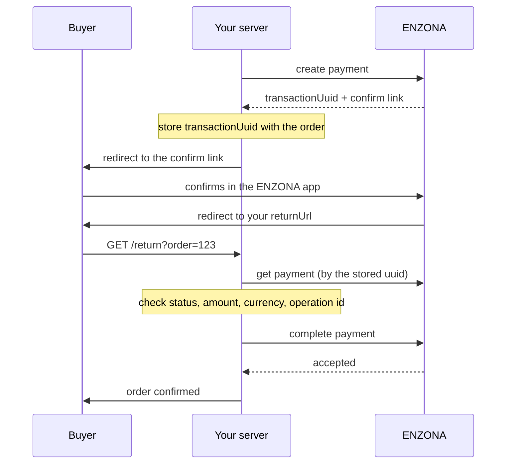

<div align="center">

# ENZONA Java SDK

**A lightweight, type-safe, framework-agnostic Java SDK for the ENZONA payment API.**

`Java 17+` · `Built with JDK 17 LTS` · `Maven & Gradle` · `Framework-agnostic` · `Community maintained`

[Quick start](#quick-start) · [Examples](examples/) · [API coverage](docs/api-coverage.md) · [Payment flow](docs/payment-flow.md) · [Español](README.es.md)

</div>

> **Unofficial SDK.** This project is community maintained and is not affiliated with, endorsed by or supported by ENZONA or XETID.

> **Status: pre-release.** `2.0.0` is a complete rewrite and **has not been published to Maven Central yet**. See [Installation](#installation) to try it locally. The `1.x` versions on Maven Central never worked against the live API: do not use them ([why](docs/migration-1.x.md)).

  

---

## Why this SDK?

- **Idiomatic and typed.** Immutable `record` responses and validating builders. No `Map<String, Object>` in your code.
- **Money is `BigDecimal`, never rounded.** ENZONA wants amounts as strings with two decimals; the SDK writes them that way and **rejects** a value with more decimals instead of rounding it. The payment total is computed from the items using the same rule the server checks, so you avoid errors 4083 and 4084.
- **Token handling included.** OAuth2 client credentials, cached until shortly before expiry, shared between threads, renewed once if the gateway rejects it.
- **Sync and async.** Every operation has a blocking method and an `...Async` method returning a `CompletableFuture`.
- **Safe by default.** HTTPS only, secrets redacted from `toString()` and exceptions, no redirects, and **no automatic retries of calls that create, complete, cancel or refund a payment**.
- **No framework coupling.** The JDK `HttpClient` and one runtime dependency (Jackson 3, kept out of the public API). The same code works in plain Java, Spring Boot, Quarkus, Micronaut or AWS Lambda.

## Features

| Feature | Since | Status |
|---|---|---|
| Payments: create, get, list with filters, complete, cancel | 2.0.0 | Implemented, tested offline |
| Refunds: full and partial, get, list, refunds of one payment | 2.0.0 | Implemented, tested offline |
| Production and sandbox environments, OAuth2 token handling | 2.0.0 | Implemented, tested offline |
| Opt-in retries for read-only calls | 2.0.0 | Implemented, tested offline |
| QR payments (`/qr/v1.0.0`) | planned 2.1.0 | Not implemented |
| Claims, accounting | unknown | No public contract |

ENZONA publishes its API reference only to registered merchants, so the contract was reconstructed from several community SDKs (see [docs/references.md](docs/references.md) and [docs/api-coverage.md](docs/api-coverage.md) for each endpoint and the open questions). "Tested offline" means contract tests against mocks and reconstructed fixtures. **Nothing has been run against ENZONA yet, and none of the tests move real money.** Try it in the sandbox first.

## Requirements

- **Java 17 or newer** (built with JDK 17 LTS, compatibility also checked on Java 21). Java 8 and 11 are not supported.
- Maven or Gradle.
- An ENZONA merchant and an application with a **consumer key and secret**, created in the ENZONA API Store after registering at [bulevar.enzona.net](https://bulevar.enzona.net). Sandbox and production use different keys.
- The consumer secret belongs on your **server**. Never ship it to a browser or a mobile app.

## Installation

> **Package status: not yet published to Maven Central.** Until it is, build it locally and depend on the snapshot:

```bash
git clone https://github.com/Alejo2075/enzona-sdk-java.git
cd enzona-sdk-java
./mvnw install -DskipTests      # needs JDK 17 or newer
```

**Maven**

```xml
<dependency>
  <groupId>io.github.alejo2075</groupId>
  <artifactId>enzona-sdk</artifactId>
  <version>2.0.0</version>
</dependency>
```

**Gradle (Kotlin DSL)**

```kotlin
repositories {
    mavenLocal()      // only until 2.0.0 is released
    mavenCentral()
}

dependencies {
    implementation("io.github.alejo2075:enzona-sdk:2.0.0")
}
```

**Gradle (Groovy DSL)**

```groovy
repositories {
    mavenLocal()      // only until 2.0.0 is released
    mavenCentral()
}

dependencies {
    implementation 'io.github.alejo2075:enzona-sdk:2.0.0'
}
```

Complete projects: [examples/plain-java](examples/plain-java) (Maven), [examples/gradle-java](examples/gradle-java) (Kotlin DSL), [examples/gradle-groovy](examples/gradle-groovy) (Groovy DSL) and [examples/return-handler](examples/return-handler) (a server for the buyer's return).

## Quick start

Export the **sandbox** credentials of your application:

```bash
export ENZONA_CONSUMER_KEY=your-consumer-key
export ENZONA_CONSUMER_SECRET=your-consumer-secret
```

Create the client once and share it (it is thread-safe and caches the access token):

<!-- snippet:plain-java/QuickStart.java#client -->
```java
EnzonaClient client = EnzonaClient.builder()
        .credentials(System.getenv("ENZONA_CONSUMER_KEY"), System.getenv("ENZONA_CONSUMER_SECRET"))
        .environment(Environment.SANDBOX)
        .build();
```

Create a payment and send the buyer to ENZONA:

<!-- snippet:plain-java/QuickStart.java -->
```java
Payment payment = client.payments().create(
        CreatePaymentRequest.builder()
                .description("Order #123")
                .currency("CUP")
                .item(PaymentItem.of("T-shirt", 2, new BigDecimal("50.00"), new BigDecimal("2.00")))
                .shipping(new BigDecimal("10.00"))
                .merchantOpId("123456789012")
                .returnUrl("https://shop.example/enzona/return?order=123")
                .cancelUrl("https://shop.example/enzona/cancel?order=123")
                .build());

System.out.println("Send the buyer to: " + payment.confirmationUrl().orElseThrow());
System.out.println("Keep this next to your order: " + payment.transactionUuid());
```

Imports:

<!-- snippet:plain-java/QuickStart.java#imports -->
```java
import io.github.alejo2075.enzona.Environment;
import io.github.alejo2075.enzona.EnzonaClient;
import io.github.alejo2075.enzona.model.CreatePaymentRequest;
import io.github.alejo2075.enzona.model.Payment;
import io.github.alejo2075.enzona.model.PaymentItem;
import java.math.BigDecimal;
```

The `total` is computed for you: `Σ(price × quantity) + tax + shipping + tip − discount`, where `tax` is the sum of the item taxes. The complete, compiling version is [QuickStart.java](examples/plain-java/src/main/java/example/QuickStart.java).

## Payment flow



There are **no signed webhooks** and ENZONA does not put the payment identifier in your `returnUrl`: keep the `transactionUuid` next to your order and put your own order reference in the return URL. **The redirect proves nothing**; the payment is only charged when you complete it. The SDK does not host an HTTP endpoint. Details: [docs/payment-flow.md](docs/payment-flow.md).

## Usage examples

### Verify the return and complete the payment

<!-- snippet:plain-java/PaymentFlow.java#checkout -->
```java
Payment payment = client.payments().create(
        CreatePaymentRequest.builder()
                .currency("CUP")
                .description("Order " + orderId)
                .item(PaymentItem.of("Course", 1, new BigDecimal("250.00"), BigDecimal.ZERO))
                .generateMerchantOpId()
                .returnUrl("https://shop.example/enzona/return?order=" + orderId)
                .cancelUrl("https://shop.example/enzona/cancel?order=" + orderId)
                .build());

// ENZONA does not put the uuid in the return URL: store it with the order now.
orders.put(orderId, new Order(orderId, payment.amount().total(), payment.currency(),
        payment.merchantOpId(), payment.transactionUuid()));

return payment.confirmationUrl().orElseThrow();
```

<!-- snippet:plain-java/PaymentFlow.java#return -->
```java
Order order = orders.get(orderId);
Payment payment = client.payments().get(order.transactionUuid());

if (payment.status() == PaymentStatus.ACCEPTED) {
    return Outcome.PAID; // already completed: handling the return twice is harmless
}
if (payment.status() != PaymentStatus.CONFIRMED) {
    return Outcome.NOT_CONFIRMED;
}
boolean matches = order.currency().equals(payment.currency())
        && order.merchantOpId().equals(payment.merchantOpId())
        && order.total().compareTo(payment.amount().total()) == 0;
if (!matches) {
    return Outcome.MISMATCH;
}

// Completing the payment is what charges the buyer. It is never retried by the SDK.
Payment completed = client.payments().complete(order.transactionUuid());
return completed.status() == PaymentStatus.ACCEPTED ? Outcome.PAID : Outcome.NOT_CONFIRMED;
```

> **Completing a payment charges the buyer.** The SDK never retries it. If a `complete` call fails with a transport error the outcome is unknown: `get` the payment and read its status before trying again.

### Refunds

<!-- snippet:plain-java/Refunds.java#partial -->
```java
Refund refund = client.refunds().create(
        transactionUuid,
        RefundRequest.builder()
                .amount(new BigDecimal("50.00"))
                .description("Damaged item")
                .build());
System.out.println("Refund " + refund.transactionUuid() + ": " + refund.status());
```

<!-- snippet:plain-java/Refunds.java#full -->
```java
return client.refunds().create(transactionUuid);
```

> A refund moves money back to the buyer and is **never retried**. After a transport error, list the refunds of the payment before refunding again.

### Asynchronous calls

<!-- snippet:plain-java/AdvancedUsage.java#async -->
```java
return client.payments()
        .getAsync(transactionUuid)
        .thenApply(Payment::status);
```

### Timeouts and retries for reads

<!-- snippet:plain-java/AdvancedUsage.java#tuned -->
```java
EnzonaClient client = EnzonaClient.builder()
        .credentials(System.getenv("ENZONA_CONSUMER_KEY"), System.getenv("ENZONA_CONSUMER_SECRET"))
        .environment(Environment.PRODUCTION)
        .connectTimeout(Duration.ofSeconds(5))
        .requestTimeout(Duration.ofSeconds(20))
        // Retries apply to reads only; create, complete, cancel and refund are never retried.
        .retryPolicy(RetryPolicy.exponentialBackoff(3, Duration.ofMillis(200), Duration.ofSeconds(2)))
        .build();
```

### Error handling

Act on the numeric code, never on the message: ENZONA messages are Spanish prose and may change.

<!-- snippet:plain-java/AdvancedUsage.java#errors -->
```java
try {
    Refund refund = client.refunds().create(transactionUuid);
    return "Refunded: " + refund.transactionUuid();
} catch (ValidationException e) {
    // The numeric ENZONA code is stable; the message is Spanish prose and may change.
    if (e.knownErrorCode().orElse(EnzonaErrorCode.UNKNOWN) == EnzonaErrorCode.PAYMENT_ALREADY_FULLY_REFUNDED) {
        return "Already refunded";
    }
    return "ENZONA rejected the refund, code " + e.errorCode();
} catch (RateLimitException e) {
    return "Too many requests, retry in " + e.retryAfter().orElse(Duration.ofSeconds(5));
} catch (AuthenticationException | TokenException e) {
    return "Check the consumer key, the secret and the environment";
}
```

| HTTP | Exception |
|---|---|
| 400 | `ValidationException` |
| 401 | `AuthenticationException` |
| 403 | `PermissionDeniedException` |
| 404 | `NotFoundException` |
| 429 | `RateLimitException` (with `retryAfter()`) |
| 5xx | `ServerException` |
| network, timeout | `TransportException` |
| token request failed | `TokenException` |

## Security

- Keep the consumer key and secret in environment variables or a secret manager; never in code or in a client app. See [SECURITY.md](SECURITY.md).
- **Never deliver goods because the buyer reached your return URL.** Look the payment up, compare its amount, currency and operation id with your order, and only then complete it ([example](examples/return-handler)).
- Handle the return idempotently: it can arrive twice.
- The SDK does not follow redirects, so the access token cannot be forwarded to another host, and never logs anything.
- Details and the threat model: [docs/security.md](docs/security.md).

## Migrating from 1.x

`2.0.0` is a rewrite with a new package (`io.github.alejo2075.enzona`) and a new API. The `1.x` line called the wrong URLs and silently returned empty objects. See the [migration guide](docs/migration-1.x.md).

## Compatibility

Works with Maven and Gradle on plain Java, Spring Boot, Quarkus, Micronaut and AWS Lambda (Java 17 runtime or newer) because it only depends on the JDK and Jackson 3, which lives in its own package and coexists with Jackson 2 (tested). There are no framework integrations; the examples are plain Java.

## Documentation

| | |
|---|---|
| [docs/api-coverage.md](docs/api-coverage.md) | Every endpoint, its status and the open questions |
| [docs/payment-flow.md](docs/payment-flow.md) | The flow, step by step |
| [docs/architecture.md](docs/architecture.md) | Design and decisions |
| [docs/security.md](docs/security.md) | Secrets, verification and what the SDK does for you |
| [docs/troubleshooting.md](docs/troubleshooting.md) | Common errors and their causes |
| [docs/references.md](docs/references.md) | Where the contract comes from |
| [docs/release.md](docs/release.md) | How a release is made |
| [CHANGELOG.md](CHANGELOG.md) | Changes by version |
| [ENZONA](https://www.enzona.net/) / [Bulevar](https://bulevar.enzona.net/) | The platform and the merchant registration |

## Contributing, roadmap and license

Contributions are welcome: see [CONTRIBUTING.md](CONTRIBUTING.md). Next: the QR API (2.1.0). Licensed under the [Apache License 2.0](LICENSE).

## Disclaimer

This is an independent project. ENZONA and XETID are not involved in it, and the API contract was reconstructed from community sources because the official reference is only available to registered merchants. Test in the sandbox before using real money, and check [docs/api-coverage.md](docs/api-coverage.md) for what is still unconfirmed.
