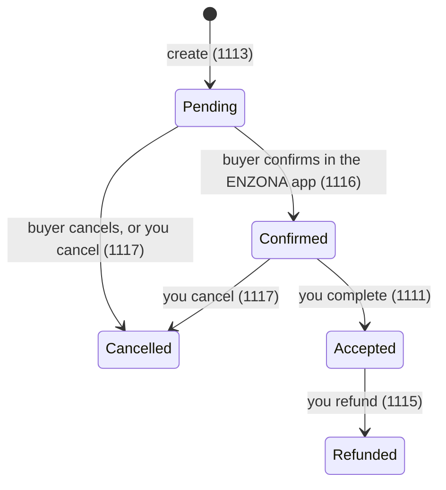

# Payment flow

How a payment travels from your shop to ENZONA and back, and what your server must do at each step. ENZONA's Payment API has **no signed webhooks**: your server drives the flow.

The numbers are the `status_code` values; `PaymentStatus` maps them and keeps unknown codes as `UNKNOWN`.

## 1. Create the payment

Call `client.payments().create(...)` with the order's items. Then:

1. **Store `transactionUuid` with the order**, together with the expected total, currency and `merchantOpId`. ENZONA does not append the identifier to your return URL, so this is the only link between the buyer's return and the payment.
2. Put your own order reference in the `returnUrl` and `cancelUrl` (for example `/enzona/return?order=123`).
3. Send the buyer to `payment.confirmationUrl()`.

`merchantOpId` identifies the operation on your side. ENZONA's SDKs describe it as a 12-digit number; `CreatePaymentRequest.newMerchantOpId()` generates one. Keep it unique per payment.

If `create` fails with a transport error (timeout, connection reset) the outcome is **unknown**: the payment may exist. The SDK does not retry it. Look the payment up by `merchantOpId` with `payments().list(PaymentQuery.builder().merchantOpId(...).build())` before creating another.

## 2. The buyer pays

The buyer confirms the payment inside the ENZONA app (or the confirmation page). ENZONA then redirects the browser to your `returnUrl` (or your `cancelUrl`).

## 3. The buyer returns

The redirect is a browser navigation: anyone can open that URL. **It proves nothing.** On this request, your server must:

1. Find the order from your own reference and read its stored `transactionUuid`.
2. `client.payments().get(transactionUuid)`.
3. If the status is already `ACCEPTED`, the payment was completed before: answer "paid" and stop. This makes reloads and repeated returns harmless.
4. If the status is not `CONFIRMED`, the buyer has not confirmed yet: wait (answer "pending").
5. Compare `amount().total()`, `currency()` and `merchantOpId()` with what you stored for the order. If they differ, stop and investigate.
6. `client.payments().complete(transactionUuid)`. **This charges the buyer.**
7. Only when `complete` returns `ACCEPTED`, deliver the goods.

[examples/return-handler](../examples/return-handler) implements exactly this, with a lock per order so two simultaneous returns complete the payment once.

### If `complete` fails

`complete` is never retried by the SDK. After a transport error the result is unknown: call `get` and read the status. `ACCEPTED` means it worked; `CONFIRMED` means it did not and you may call `complete` again.

## 4. Cancelling

If the buyer abandons the flow, ENZONA sends them to `cancelUrl`. Call `payments().cancel(transactionUuid)` so the payment does not stay pending. You can also cancel from your side before completing.

## 5. Refunds

After a payment is `ACCEPTED`, `client.refunds().create(transactionUuid)` refunds all of it; pass a `RefundRequest` with an amount for a partial refund. ENZONA rejects a refund above what is left (error 4068 or 4069) and a second full refund (4067). The SDK never retries a refund; after a transport error call `refunds().listForPayment(transactionUuid)` before trying again.

## What the SDK does not do

- It does not host HTTP endpoints. [examples/return-handler](../examples/return-handler) shows one with the JDK's built-in server.
- It does not store orders or payments. You keep that state.
- It does not poll. If you want to catch buyers who never return, list `PENDING` payments periodically and cancel the stale ones.
